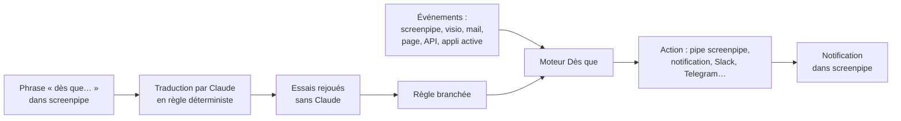

# Dès que

**Donnez des réflexes à la mémoire de screenpipe : « dès que X, fais Y ».**

Projet du hackathon screenpipe **« Build Agents That Remember »** · 42 Paris · 16–18 octobre 2026

## La démo en 1 min 46

[](docs/demo/des-que-demo.mp4)

**[▶ Voir la vidéo complète (MP4, 1 min 46)](docs/demo/des-que-demo.mp4)** : deux phrases écrites dans le chat de screenpipe deviennent deux réflexes. Un article dont les sources sont vérifiées dès qu'on quitte Pages, et un formulaire administratif rempli dès qu'on l'ouvre. Toutes les données sont fictives.

---

## Le problème

[screenpipe](https://screenpipe.com) enregistre tout ce qui passe sur votre ordinateur (écran, audio, réunions) et vous permet d'y chercher. Votre machine **se souvient** de tout. Mais elle **ne réagit à rien** : il faut toujours penser à lui demander.

screenpipe prévoit même des pipes qui se lancent « dès que » quelque chose arrive, écrit en langage naturel (`trigger.custom`). Il les enregistre, **mais ne les évalue jamais**.

## Notre réponse

**Dès que** est le moteur qui manquait. Vous dites une phrase dans screenpipe, et votre ordinateur agit **au moment où la réalité se produit**, avec ce dont il se souvient.

> « Dès que le casque audio passe sous 100 €, préviens-moi. »
> « Dès qu'un client m'envoie un mail avec "devis", rappelle-moi ce que j'avais vu sur ce dossier. »
> « OK Claude, quel prix j'avais donné pour ce devis ? » (en pleine visio)

## Ce qui marche, vérifié en réel

| Cas | Ce qui se passe |
| --- | --- |
| **Une phrase devient un réflexe** | « Add trigger › Dès que… » dans screenpipe : Claude traduit la phrase en règle déterministe, le moteur rejoue des essais, puis la branche |
| **La source qui se crée seule** | « dès que le bitcoin dépasse 50 000 » : le moteur trouve une API publique de cours, la lit, la surveille |
| **Le prix qui baisse** | la page change, la notification arrive dans screenpipe en quelques secondes |
| **Le mail qui compte** | un mail arrive, la pipe screenpipe se lance, la notification suit |
| **La mémoire en pleine visio** | « OK Claude, quel était le prix du casque ? » : réponse en ~2 s, **avec l'heure, l'appli et la citation exacte de l'écran** |

Les cas du journaliste (« dès que j'écris mon enquête, source ce que je dis ») et de l'administratif (« dès que j'ouvre ce formulaire, remplis-le ») sont validés sur la branche `dev2/briques`, pas encore fusionnée. Le catalogue complet, avec l'état de chaque cas : [`docs/CAS-DUSAGE.md`](docs/CAS-DUSAGE.md).

## Comment ça marche



1. **Les règles naissent dans screenpipe** : « Add trigger › Dès que… », la pastille « Event API » du chat, ou une phrase au chat.
2. **Le moteur** (Bun, local) traduit chaque déclencheur avec Claude en conditions vérifiables, crée au besoin la source qui l'écoute, rejoue des essais, puis branche la règle.
3. **Quand l'événement arrive**, la règle se déclenche : le moteur lance la pipe, et l'agent de screenpipe exécute l'action.
4. **Le copilote de visio**, réveillé par « OK Claude », répond avec la transcription de l'appel **et la mémoire de l'écran**.

Trois briques :

- **A. Le moteur « dès que »** : événements, règles, actions. Le cœur, opérationnel.
- **B. L'ouverture** : proposer des automatisations à partir de ce que vous faites déjà. L'interface et le contrat existent ; la génération des propositions à partir de la mémoire est la prochaine étape.
- **C. Le copilote de visio** : « OK Claude » au micro, seulement pendant une visio.

## Sécurité, par conception

- **Le moteur reste sur la machine** : il n'écoute que `127.0.0.1` et refuse les requêtes des autres sites. Ne sortent que les appels à Claude, les sources web que vous surveillez et les actions que vous configurez (Slack, Telegram…).
- **Transcriptions, mails, pages et écrans sont des données non fiables.** Claude ne choisit jamais une destination : elle est fixée par la règle.
- **Une pipe ne reçoit jamais le texte d'un mail ou d'une page** (son agent a un shell) : seulement des nombres et des valeurs fermées, lues par Claude dans le moteur.
- **Le copilote de visio garde la validation humaine** : ce qu'il propose d'envoyer attend un clic.
- Les garanties du pont sont testées en cassant volontairement le code : 129 versions cassées, 126 détectées, les 3 autres sans effet observable.

## Démarrer

Prérequis : [Bun](https://bun.sh) 1.3+, screenpipe installé et connecté à un compte, une clé Claude.

```sh
bun install
cp .env.example .env    # puis remplir les clés
bun test                # 127 tests
bun run dev             # http://127.0.0.1:4300
```

Dans `.env` (jamais commité) :

| Variable | Valeur |
| --- | --- |
| `SCREENPIPE_LOCAL_API_URL` | `http://localhost:3030` (appli installée) ou `http://localhost:3130` (version modifiée en mode isolé) |
| `SCREENPIPE_LOCAL_API_KEY` | screenpipe › Réglages › Confidentialité |
| `ANTHROPIC_API_KEY` | console Claude |

Essayer sans source réelle (screenpipe ouvert) :

```sh
bun run evt web valeur_changee '{"nom":"Casque audio","valeur":89,"valeurTexte":"89","ancienne":"120"}'
```

La règle d'exemple se déclenche, et la notification arrive dans screenpipe.

**Le bouton « Dès que… » dans screenpipe** demande notre version modifiée de l'appli : 4 correctifs d'interface, sans Rust, à appliquer sur screenpipe `app-v2.7.109`. Mode d'emploi : [`screenpipe-correctif/LISEZMOI.md`](screenpipe-correctif/LISEZMOI.md).

## Le dépôt

| Chemin | Rôle |
| --- | --- |
| `src/moteur.ts` | règles, conditions, exécution des actions, journal |
| `src/pipes-des-que.ts` | le pont : traduit les déclencheurs des pipes screenpipe, rejoue les essais, branche |
| `src/copilote.ts`, `src/assistant.ts` | copilote de visio : phrase d'appel, réponse avec mémoire et citations |
| `src/screenpipe.ts` | client de l'API screenpipe, recherche dans la mémoire de l'écran |
| `src/sources/` | sources d'événements : page web, mail (IMAP), appli active |
| `src/actions.ts` | exécuteurs : notification, Slack, Telegram, Discord, webhook, pipe, ouvrir une page |
| `src/claude.ts`, `src/regle-en-francais.ts` | appels à Claude (JSON par schéma), traduction d'une phrase en règle |
| `src/serveur.ts`, `public/index.html` | serveur local et console de suivi (`127.0.0.1:4300`) |
| `regles.json` | règles communes ; celles propres à une machine vont dans `regles.local.json`, hors git |
| `screenpipe-correctif/` | nos correctifs de l'appli screenpipe (le déclencheur « Dès que… », Event API, notifications) |
| `docs/` | cas d'usage, référence screenpipe vérifiée, plan |

## Limites connues

- La surveillance tourne dans le moteur, un programme à lancer à côté de screenpipe ; l'intégrer à l'appli est la prochaine étape.
- En formule gratuite, screenpipe ne remonte que 24 h d'historique et 2 pipes personnelles.
- La transcription des visios passe par le service cloud de screenpipe (environ 2 à 5 s de délai).
- La mémoire voit tout ce qui passe à l'écran : pour une démo, session propre et données fictives.

## L'équipe

**Abel Melman** · **Bielorretto** · **NewbieCae**

Développé avec [Claude Code](https://claude.com/claude-code). Vidéo de démo : voix générée avec ElevenLabs ; musique « Dark Star » par Infraction. screenpipe est sous sa propre licence : ce dépôt n'en contient pas le code, seulement nos correctifs, destinés à être proposés à screenpipe.
